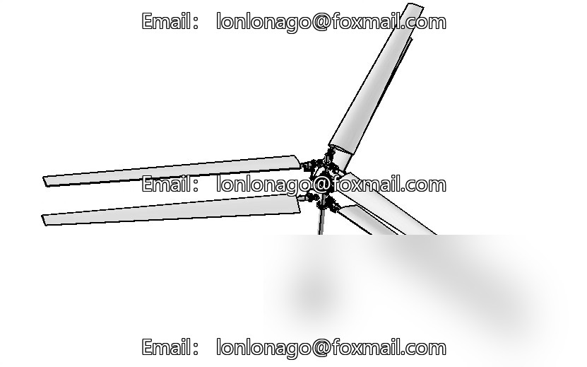
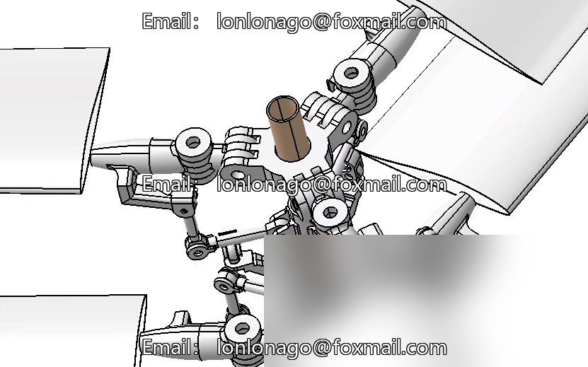
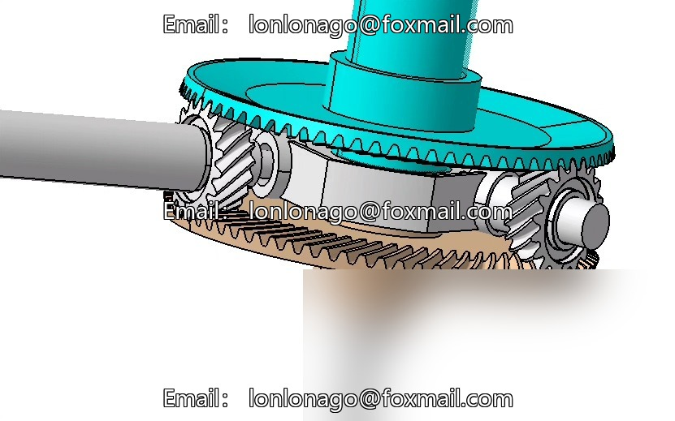
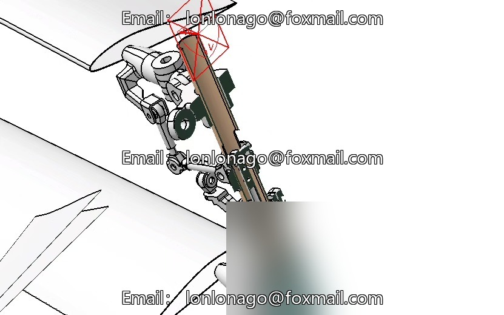

# Helicopter monoplane twin-spin 3D, 3D diagram - available with Catia UG Soli

## Body

Helicopter coaxial twin-spinning 3D, three-dimensional diagrams can be opened and edited with Catia UG SolidWorks and other software.
There are other various types of 3D drawings for A010, including modeling and modification of model and data, etc., specific details to be discussed further.

The image shows a helicopter coaxial dual rotor 3D model and three-dimensional diagrams, openable with Catia, UG, Soli and other tools; modeling and modulus modification services for other types of 3D drawings are also offered.

<!-- AI_ENRICHED -->

## Images

## Payment

Here is a pay link on Stripe ( https://buy.stripe.com/3cs8yP7sY87d0vu9AB ). Please contact me lonlonago@foxmail.com after funding $89, and I will send you a complete data files , thank you!

